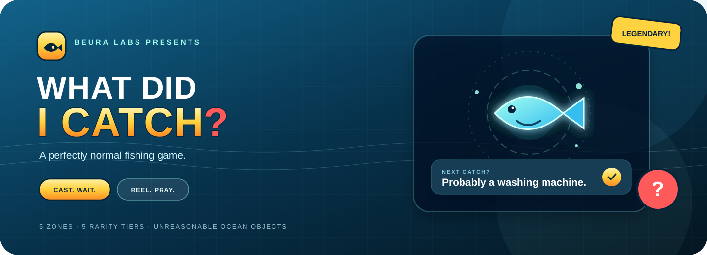
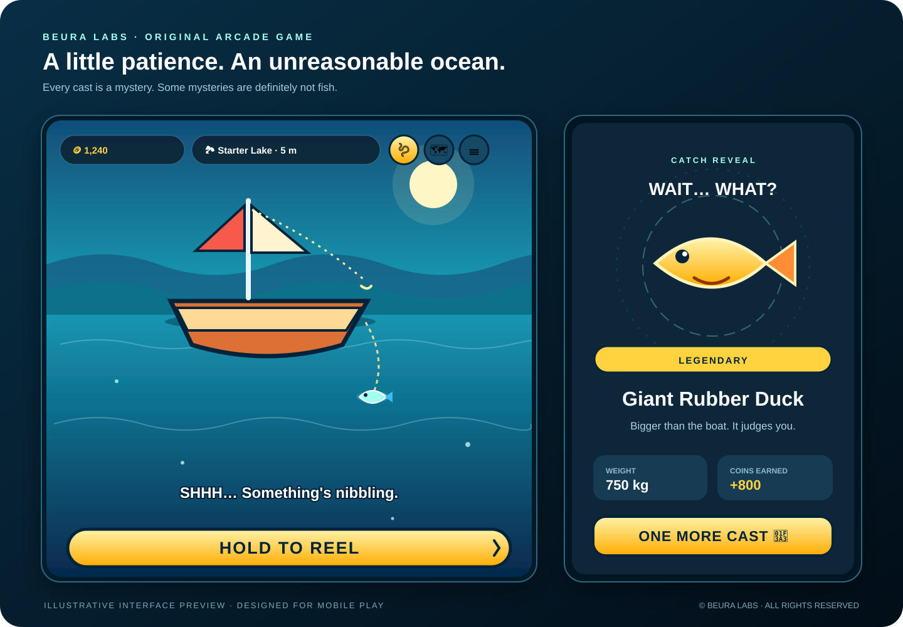

  

  

  

    
    
    
  

  
<strong>Cast. Wait. Reel. Pray.</strong> The ocean is full of fish. And suspiciously many non-fish.

## Take a look

*Illustrative interface preview, not a raw gameplay screenshot.*

## What’s in the water?

- **Five waters to explore:** Starter Lake, Coastal Beach, Deep Ocean, The Abyss, and the highly questionable Mystery Zone.
- **A growing collection:** five rarity tiers, size variants, odd objects, secret catches, biggest-catch records, and achievements.
- **Gear that matters:** upgrade rods, reels and line; unlock sonar and a magnetic reel; choose your bait carefully.
- **A living ocean:** changing day and night, weather, special events, particles, synthesized sound effects and music.
- **Made for quick sessions:** responsive canvas rendering, mouse/touch controls, reduced-motion and quality settings.

## How to play

1. Tap **CAST** (or tap the play area) and wait for a bite.
2. Tap quickly when the bite prompt appears.
3. **Hold to reel** and release when the tension is getting too high. Red is the ocean politely telling you to stop.
4. Spend coins on upgrades, unlock deeper waters, and fill your collection.

## Progress & privacy

The game is a single HTML file with no build step or application server. Your progress and collection are saved in browser `localStorage` on that browser/device. There is no account system or cloud sync, so browser data clearing or changing devices can reset progress. Use a regular browsing session if you want your save to persist.

## Run locally

Open `index.html` in a modern browser, or deploy this repository to Vercel as a static site. The game uses Canvas 2D and the Web Audio API; audio starts after interaction, as browsers require.

## Copyright

**© 2026 Satyajit Beura / Beura Labs. All rights reserved.** See [LICENSE](LICENSE). No permission to copy, modify, redistribute, publicly host, or commercially use this project is granted without prior written permission, except where applicable law allows otherwise.

  Made by Beura Labs · Catch responsibly. Suspiciously large objects may occur.

